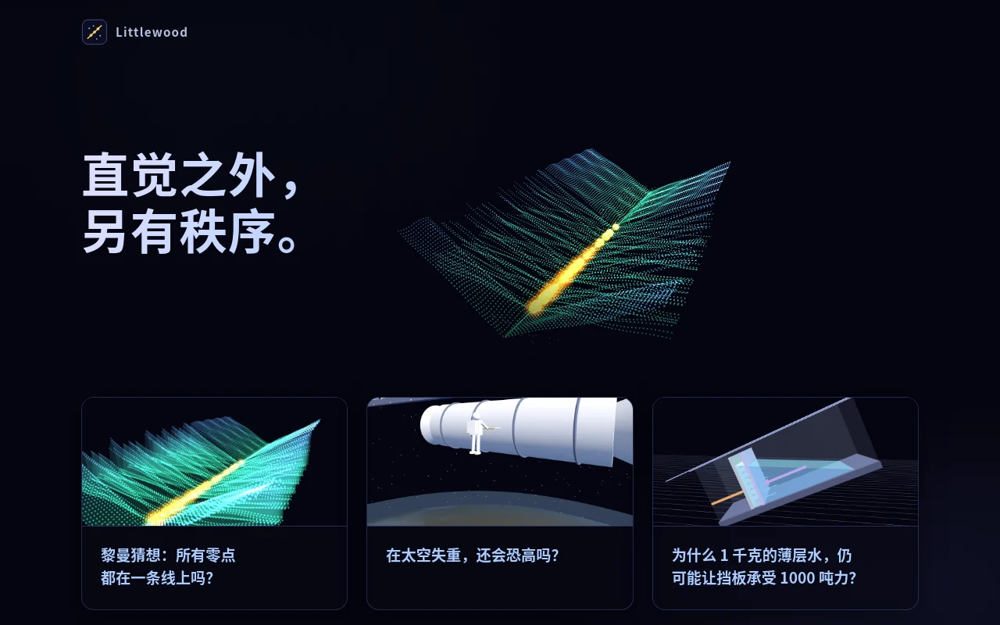
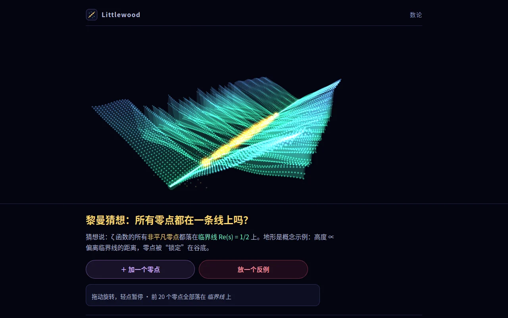
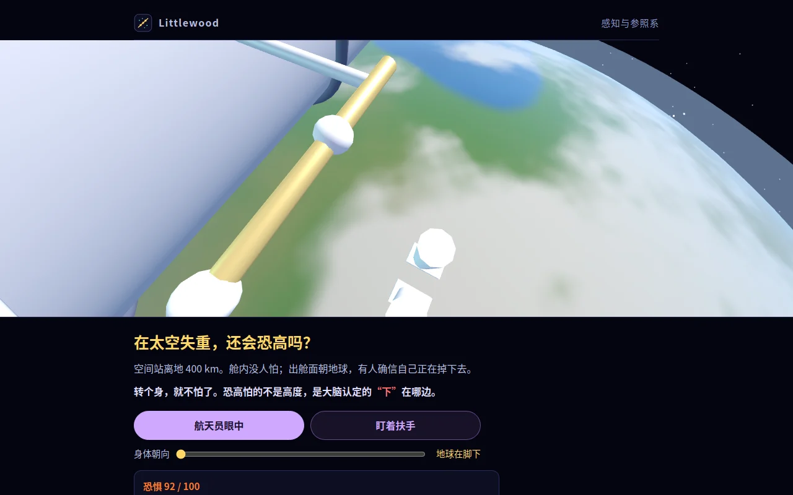
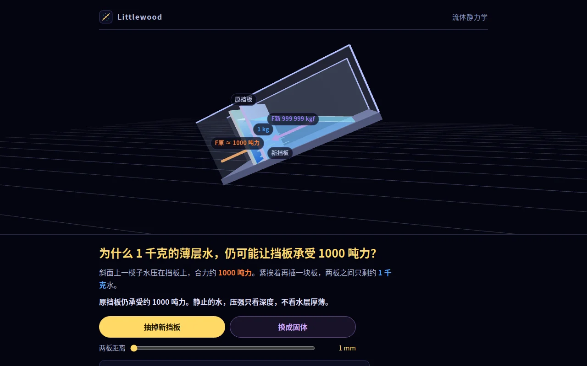

<p align="center"><picture><source media="(prefers-color-scheme: dark)" srcset="public/logo.svg"></picture></p>

<p align="center">直觉之外，另有秩序。<br><a href="https://littlewood.io">littlewood.io</a></p>

每篇只问一个看起来不可能的科学问题，用一个可以转、可以动手的 3D 场景把它讲明白。



## 页面

| | |
|---|---|
|  | **[黎曼猜想：所有零点都在一条线上吗？](https://littlewood.io/riemann-hypothesis)**<br>零点地形：高度正比于偏离临界线的距离，前 20 个零点锁在谷底。可以加零点、放一个假想反例看它被迫成四个一组。 |
|  | **[在太空失重，还会恐高吗？](https://littlewood.io/space-acrophobia)**<br>抓着空间站扶手，切到航天员眼中低头看 400 km 下的地球；转个身让地球到头顶，恐惧消失。 |
|  | **[为什么 1 千克的薄层水，仍可能让挡板承受 1000 吨力？](https://littlewood.io/hydrostatic-paradox)**<br>斜面水槽里插一块新挡板、拖动两板距离、换成固体，看原挡板上的力为什么纹丝不动。 |

## 结构

静态站点，无构建步骤，全部在 `public/`：

- `index.html` 首页：标语 + 三张卡片，背景是黎曼页的 three.js 场景
- `riemann-hypothesis.html`、`space-acrophobia.html`、`hydrostatic-paradox.html` 三个全屏 3D 场景页，共用 `scene.css`（上下结构：顶栏、场景、文字面板）和 `scene.js`（把场景装进舞台）
- `site.css` 全站令牌和深色主题；`mark.svg` / `favicon.svg` / `logo.svg` 同一个标志
- three.js r128 自托管在 `vendor/`，CSP 只允许本站资源

## 部署

Cloudflare Worker 静态资源，域名 littlewood.io。push 到 `main` 自动部署，或手动：

```sh
npx wrangler deploy
```
